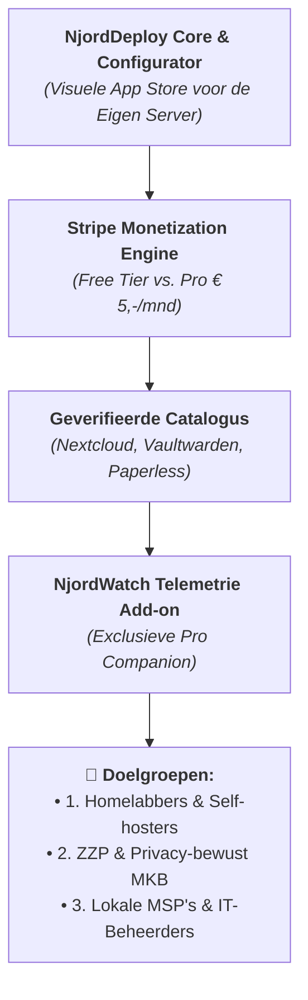
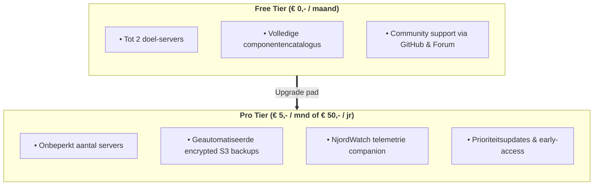
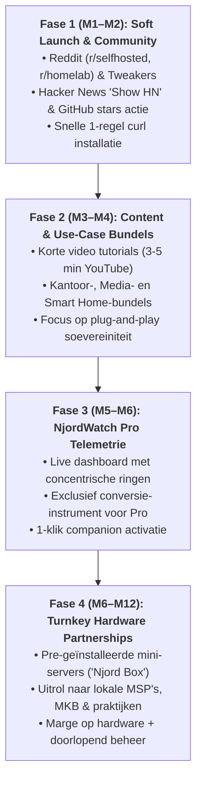

# 🚀 NjordDeploy: Aangescherpte Commerciële Roadmap & Go-to-Market Strategie

**Document:** Strategisch Product- & Go-to-Market Memorandum
**Auteur:** Henk van Hoek & Antigravity
**Datum:** 11 oktober 2026
**Status:** Definitief / Commerciële Roadmap
**Doel:** Het vastleggen van een scherpe, haalbare commerciële route naar brede adoptie, abonnee-groei en verdienmodellen voor het NjordDeploy ecosysteem.

---

## Executive Summary

Waar **SysOps Cockpit** fungeert als het interne, geavanceerde mission-control center voor complexe vloten, is **NjordDeploy** hét kant-en-klare, schaalbare **commerciële product**.

NjordDeploy lost het grootste probleem op in de hedendaagse self-hosting markt:
> *Mensen willen soevereiniteit, privacy en on-premise applicaties, maar 95% van de potentiële gebruikers haakt af op de complexiteit van handmatige Docker Compose files, reverse proxies, poorttoewijzingen en netwerkconfiguraties.*

NjordDeploy fungeert als de **"App Store voor de Eigen Server"**. Het combineert een visuele browser-configurator met een geautomatiseerde componentencatalogus en een geteste **Stripe Billing & Subscription engine**.

Dit document presenteert de aangescherpte positionering, de doelgroepen, het prijsmodel en de 4-fasen go-to-market roadmap.

---

## 1. De Huidige Productierijpe Staat (Het Fundament)

NjordDeploy is géén concept meer op de tekentafel; het fundament is al gebouwd, getest en operationeel:

1. **Publieke Showcase Website (`njorddeploy.com`):**
   * Snelle Caddy edge showcase met dynamische componentencatalogus, FAQ en documentatie.
2. **Volledige Stripe Billing & Subscription Engine:**
   * **Stripe Checkout integratie:** Ondersteunt iDEAL, Wero en Creditcards.
   * **Stripe Customer Portal:** Klanten beheren zelf facturen, downloads van PDF-nota's en betaalmethoden.
   * **Webhook-gestuurde Lifecycle:** Automatische activatie, quota enforcement (max 2 servers op Free, onbeperkt op Pro) en vlekkeloze heractivatie bij opzegging (zie [`STRIPE_BILLING_LIFECYCLE_TEST_PLAN.md`](file:///home/hvhoek/PycharmProjects/njord-deploy/docs/STRIPE_BILLING_LIFECYCLE_TEST_PLAN.md)).
3. **Geautomatiseerde Componenten Catalogus & QA:**
   * Meer dan 50 geverifieerde stacks (Nextcloud, Vaultwarden, Paperless-ngx, Home Assistant, Gitea, etc.).
   * Autonome semver upgrade radar en geautomatiseerde integratietests op Proxmox VE.

---

## 2. Doelgroepen & Waardepropositie

| Segment | Wie zijn zij? | Grootste Pijnpunt | Hoe NjordDeploy dit oplost |
| :--- | :--- | :--- | :--- |
| **1. Homelabbers & Self-hosters** | Tech-enthousiastelingen, privacy-voorvechters, Raspberry Pi bezitters | YAML-moeheid, poortconflicten, urenlang debuggen van Nginx | 1-klik visuele deployment via de browser; werkend binnen 3 minuten. |
| **2. Privacy-bewust MKB / Vrije Beroepen** | Tandartsen, notarissen, accountants, architecten | AVG/GDPR-risico's in US clouds, maar geen budget voor een fulltime Linux-beheerder | Veilige, lokale turnkey stacks (Nextcloud bestanden, Vaultwarden wachtwoorden). |
| **3. Lokale MSP's & IT-Beheerders** | IT-bedrijven die 10-50 lokale MKB-klanten bedienen | Tijdgebrek bij onboarding en standaardisatie van lokale servers | Gestandaardiseerde, reproduceerbare uitrol zonder handmatig scriptwerk. |

---

## 3. Verdienmodel & Prijsstrategie

Het verdienmodel is gebaseerd op het beproefde **Freemium "Land and Expand" model** (zoals Docker, Portainer en Tailscale):

### Waarom € 5,- per maand de "Sweet Spot" is:
* Het is een **geen-denk-nodig bedrag** (*no-brainer pricing*). Voor de prijs van één kop koffie per maand heeft een gebruiker onbeperkte vrijheid en backups.
* Lage drempel zorgt voor een hoge conversieratio onder tevreden Free Tier-gebruikers.
* Jaarabonnement met korting: **€ 50,- per jaar** (twee maanden gratis).

---

## 4. De 4-Fasen Commerciële Roadmap

### Fase 1: Soft Launch & Community Adoptie (Maand 1 – 2)
* **Doel:** De eerste 500 actieve installaties en 25 betalende Pro-abonnees realiseren.
* **Acties:**
  * Publicatie op Reddit: `r/selfhosted`, `r/homelab`, `r/Proxmox` en `r/raspberry_pi` met een aantrekkelijke GIF-demo (*"I built a browser app store for self-hosted servers"*).
  * Showcase op Tweakers.net (in het Server & Storage / Homelab forum).
  * *"Show HN"* post op Hacker News.
  * Focus op wrijvingsloze installatie: één curl-regel om NjordDeploy direct te starten op een schone Debian/Ubuntu/Pi machine.

### Fase 2: Content Marketing & Use-Case Bundels (Maand 3 – 4)
* **Doel:** Positioneren als de gouden standaard voor specifieke taken.
* **Acties:**
  * **Use-Case Bundels introduceren:** In plaats van losse containers, complete workflows promoten:
    * *De Digitale Kantoor Bundel:* Paperless-ngx + Nextcloud + Vaultwarden.
    * *De Media & Creator Bundel:* Immich (foto's) + Jellyfin + Transmission.
    * *De Smart Home Shield Bundel:* Home Assistant + AdGuard Home + WireGuard.
  * Korte YouTube walkthrough video's (3-5 minuten) waarin te zien is hoe je binnen 5 minuten een complete kantoor-stack installeert.

### Fase 3: NjordWatch als Exclusieve Pro Add-On (Maand 5 – 6)
* **Doel:** De conversie van Free naar Pro aanzienlijk verhogen.
* **Acties:**
  * **De rol van NjordWatch zuiveren:** NjordWatch wordt uitgebracht als een lichte, containerized companion app.
  * Klanten met een Pro-abonnement krijgen in NjordDeploy een schakelaar: *"Activeer NjordWatch Live Telemetrie"*.
  * Met één klik verschijnt het prachtige dashboard met concentrische ringen (CPU, RAM, Disk, Uptime) voor al hun actieve servers.

### Fase 4: Turnkey Hardware Partnerships (B2B / MKB) (Maand 6 – 12)
* **Doel:** Doordringen tot het niet-technische MKB via fysieke apparaten.
* **Acties:**
  * Samenwerking verkennen met fabrikanten van compacte mini-servers (bijv. Protectli, Minisforum of lokale systeembouwers).
  * **"De Njord Sovereign Box":** Een fluisterstille hardware-server met Proxmox en NjordDeploy pre-geïnstalleerd.
  * Uitrol naar tandartsen, notarissen en administratiekantoren via lokale IT-partners met een marge op de hardware én een doorlopend beheercontract.

---

## 5. Succesindicatoren (KPI's) voor Jaar 1

| KPI | Doel na 6 Maanden | Doel na 12 Maanden |
| :--- | :---: | :---: |
| **GitHub Stars** | 500+ | 2.000+ |
| **Actieve Installaties (Free Tier)** | 1.000 | 5.000 |
| **Betalende Pro Abonnees (€ 5,-/mnd)** | 50 (€ 250,- MRR) | 250 (€ 1.250,- MRR) |
| **Turnkey MKB Appliances Verkocht** | 5 testpilots | 25 actieve appliances |

---

## Conclusie

NjordDeploy heeft alle ingrediënten in handen om uit te groeien tot een succesvol, rendabel open-core platform. Door de commerciële propositie strak te focussen op **gebruiksgemak, de € 5,-/mnd Pro tier en handige use-case bundels**, spreken we een wereldwijde markt aan die snakt naar datasoevereiniteit zonder technische hoofdpijn.
