# NjordDeploy Fleet Update Management System (FUMS) - Design Document

**Document Version:** 1.3.0
**Status:** Architectural Blueprint & Production Specification
**Date:** 2026-09-14
**Author:** Henk van Hoek & Antigravity
**Domain:** njorddeploy.com

---

## 1. Executive Summary & Context

NjordDeploy provides containerized self-hosted stacks (such as the *Sovereign Stack*) for paying enterprise and prosumer clients. While container technologies allow continuous software updates, unmanaged or fully automatic update cycles (e.g., blind Watchtower triggers) carry significant risks of unexpected downtime, breaking schema migrations (e.g., PostgreSQL major versions), and incompatibility with customer operations (such as scheduled hardware maintenance or peak operating hours).

This design document outlines the **Fleet Update Management System (FUMS)**. FUMS is hosted centrally on **VM 140** (`njorddeploy-vm`) and implements a customer-centric **Approval & Dispatch Workflow** backed by:
1. **Release Intelligence AI Agent (RISA)** for upstream changelog and diff mining.
2. **Dual-Mode Proxmox Staging Sandbox ("De Proeftuin")**:
   - *Mode A (Gatekeeper)*: Automated zero-risk synthetic verification of database migrations.
   - *Mode B (Interactive Training & UAT)*: On-demand customer sandboxes for staff training, documentation, and formal acceptance testing prior to production rollout.
3. **Air-Traffic-Control Grade Execution Engine** with atomic database rollbacks.

### Core Guiding Principle:
> *"The platform detects releases, analyzes breaking changes via AI, verifies updates in an isolated Proxmox sandbox, and offers on-demand interactive customer training environments; the customer retains absolute control over business timing, user readiness, and deployment strategy."*

---

## 2. Architectural Overview

```mermaid
flowchart TD
    %% 1. Detection & AI Intelligence
    subgraph S1 ["1. Detection & AI Release Intelligence (VM 140 Hub)"]
        MON["DIUN / Registry Monitor"] -->|New version detected| AI_AGENT["🤖 Release Intelligence AI Agent (RISA)"]

        subgraph RISA_Process ["RISA Deep Inspection Cycle"]
            AI_AGENT --> GITHUB_API["1. Analyze GitHub Release Notes & Changelogs"]
            AI_AGENT --> DIFF_CHECK["2. Git Diff Compose/Env & Schema Changes"]
            AI_AGENT --> RISK_CLASSIFY["3. Risk Classification:<br/>(Green: Routine / Orange: Env / Red: Major/Breaking)"]
        end
    end

    %% 2. The Proeftuin Sandbox (Mode A: Gatekeeper)
    subgraph S2 ["2. Proeftuin Mode A: Automated Gatekeeper (Proxmox)"]
        RISK_CLASSIFY -->|Red or Major Version Update| SANDBOX["Launch Ephemeral Proxmox Sandbox"]
        SANDBOX --> PROV["Spin up temporary clone / LXC container"]
        PROV --> SEED["Seed with anonymized DB schema / target config"]
        SEED --> TEST_UPDATE["Execute migration & container launch"]
        TEST_UPDATE --> TEST_HC{"Automated Integration & Health Test"}

        TEST_HC -->|Test Fails| AI_DIAG["AI Root Cause Analysis & Quarantine<br/>(Alert Henk directly; DO NOT offer update to clients)"]
        TEST_HC -->|Test 100% Passes| CERT["✅ Release Certified in Proeftuin Sandbox"]
        CERT --> DESTROY_GK["Destroy Gatekeeper Container (Clean)"]
    end

    %% 3. Customer Interaction & Decision Matrix
    subgraph S3 ["3. Customer Interaction & Decision Matrix (Signal / Matrix / Email)"]
        RISK_CLASSIFY -->|Green / Routine Patch| DISP["Notification Dispatcher"]
        CERT --> DISP

        DISP -->|Recommendation + Certification + Options| NOTIF["Customer Channel<br/>(Signal / Matrix / Email / Web)"]

        NOTIF --> CLIENT{"Customer Decision:"}

        %% Option 1: Direct or Scheduled Production Rollout
        CLIENT -->|Option 1: Production Rollout| PROD_REQ["Select Timing (Immediate/Night/Date)<br/>& Method (High-Safety / Fast)"]
        PROD_REQ --> API["NjordDeploy Approval API<br/>(VM 140:5001)"]

        %% Option 2: Interactive Training Sandbox
        CLIENT -->|Option 2: Request Training/UAT| TRAIN_REQ["Request Training Sandbox<br/>(e.g., 7 or 14 days TTL)"]
        TRAIN_REQ --> API
    end

    %% 4. Proeftuin Mode B: Interactive Customer Training Environment
    subgraph S4 ["4. Proeftuin Mode B: Interactive Customer Sandbox (Training & UAT)"]
        API -->|On Training Request| PROV_TRAIN["Spin up Isolated Training LXC on Proxmox"]
        PROV_TRAIN --> MASK_DATA["Import masked/anonymized data"]
        MASK_DATA --> TRAIN_URL["Issue Secure URL:<br/>https://training-client.njorddeploy.com"]

        TRAIN_URL --> TRAIN_OPS["Customer trains staff, prepares documentation<br/>and executes UAT acceptance tests"]
        TRAIN_OPS --> UAT_SIGNOFF["Key User grants formal UAT Sign-off"]
        UAT_SIGNOFF --> API
        UAT_SIGNOFF --> DESTROY_TRAIN["Teardown & Cleanup of Training Environment"]
    end

    %% 5. Scheduling & Task Queue
    subgraph S5 ["5. Scheduling & Task Queue (VM 140 Hub)"]
        API -->|On Production Go-Live| DB[("SQLite Task Queue<br/>(Scheduled jobs & methods)")]
        DB -->|Trigger at scheduled time| LOCK["Acquire Lockfile<br/>(/run/njord_updating.lock)"]
        LOCK --> RUNNER["Ansible Update Orchestrator"]
    end

    %% 6. Target Host Execution
    subgraph S6 ["6. Target Host / Customer Stack (LXC / VM)"]
        RUNNER --> PRE_CHECK{"Disk Space Pre-flight:<br/>>= 2.5x Image + DB size?"}

        PRE_CHECK -->|Insufficient space| FAIL_SPACE["Abort & Report: Disk full"]
        PRE_CHECK -->|Sufficient space| PRE_ACTION["Pre-Flight Strategy (RISA Recipe):<br/>- CoW Snapshot or Atomic DB Dump + Config<br/>(Exclude bulk media uploads!)"]

        PRE_ACTION --> DEPLOY["Container Update:<br/>docker/podman compose pull & up -d"]
        DEPLOY --> HC{"Health Check OK?<br/>(HTTP 200 & Container State)"}

        HC -->|YES: Success| CLEAN["Retain snapshot & prune old images"]
        HC -->|NO: Failure| ROLLBACK["Automated Atomic Rollback:<br/>Restore DB Dump/Volume + restart previous tag"]
    end

    %% 7. Feedback, Sign-off & Escalation
    subgraph S7 ["7. Feedback, Sign-off & Escalation"]
        CLEAN --> REPORT_OK["Status Report: SUCCESS<br/>- Downtime duration recorded<br/>- New version numbers active"]
        ROLLBACK --> REPORT_FAIL["Alert Report: FAILED & RESTORED<br/>- Failure reason transparent<br/>- Rollback status verified"]

        REPORT_OK --> CLIENT_FEEDBACK["Customer Notification (Signal / Matrix / Email)"]
        REPORT_FAIL --> CLIENT_FEEDBACK

        REPORT_FAIL --> ADMIN_ESCALATE["🚨 Priority Alert to Administrator (Henk)<br/>(Instant alert via Signal for recipe investigation)"]

        REPORT_OK --> AUDIT[("Audit Log & Obsidian Logbook<br/>(Henk's Memory)")]
        REPORT_FAIL --> AUDIT
    end
```



---

## 3. The Two Modes of "The Proeftuin" (Staging Sandbox)

### 3.1. Mode A: Automated Gatekeeper (Synthetic & Ephemeral)
* **Objective:** 100% prevention of broken upstream updates or failing database migrations from ever reaching a customer.
* **Trigger:** Fully autonomous as soon as RISA classifies an update as **RED** or **Major Version**.
* **Duration:** A few minutes.
* **Operation:**
  1. Spawns an ephemeral LXC/clone on Proxmox via [`scripts/proxmox_test_runner.py`](file:///home/hvhoek/PycharmProjects/njord-deploy/scripts/proxmox_test_runner.py).
  2. Executes the migration against an anonymized database schema.
  3. Verifies container status and API endpoints (`healthy` status / HTTP 200).
  4. On failure: **Quarantine**. Henk receives an instant bug report; the update is blocked and never offered to clients.
  5. On success: The certification badge *"Certified in Proeftuin Sandbox"* is awarded. The container is immediately destroyed.

### 3.2. Mode B: Interactive Customer Sandbox (Training & UAT)
* **Objective:** Train staff, capture screenshots/manuals, and conduct formal Customer Acceptance Testing (UAT) prior to go-live.
* **Trigger:** Requested on-demand by the customer via Signal/Matrix or the web portal upon a major update.
* **Duration:** 7 to 14 days (with automated Time-To-Live).
* **Data Privacy & Dummy Seeding (KISS):**
  - *Default:* Uses a **clean 'seed' database** with dummy accounts and test data. Fully GDPR/AVG compliant, instantly operational, and eliminates all risk of leaking personal data.
  - *Custom:* Data-masking on customer data strictly upon explicit request with dedicated transformation scripts and a formal Data Processing Agreement (DPA).
* **Network Isolation & Mailpit Catcher:**
  - Outgoing SMTP and webhook connections in training environments are intercepted and routed to a local dummy catcher (**Mailpit**). Prevents trainees from accidentally emailing real clients or suppliers.
* **Resource Management & Concurrency Quota:**
  - **Quota:** Maximum of 3 concurrent active customer sandboxes on Proxmox.
  - **Nightly Sleep:** Training containers are automatically paused/stopped outside business hours (19:00 - 07:00) to keep CPU and RAM available.
* **UAT Sign-off:** As soon as the key user provides formal **UAT Sign-off**, FUMS schedules the production update and automatically tears down the training container.

---

## 4. Technical Pillars & Safeguards

### 4.1. Release Intelligence AI Agent (RISA) Token Hygiene
* To prevent token explosions and context-window overflows when processing massive upstream changelogs, RISA employs a **pre-filtering pipeline**:
  - **Targeted File Inspection:** Inspects exclusively `docker-compose.yml`, `Dockerfile`, `.env.example`, `MIGRATION.md`, and release highlights (no raw application source code).
  - **Regex Prioritization:** Filters release notes primarily on signal keywords: `BREAKING`, `DEPRECATED`, `DATABASE`, `MIGRATION`, `ENV_VAR`, `SCHEMA`.
* Based on this, generates a compact machine recipe (JSON) for Ansible as well as an understandable summary for the customer.

### 4.2. The Database Migration Rollback Dilemma (Atomic State)
* Under **High-Safety**, Database Dump + Config State constitute an indivisible atomic unit.
* If the health check fails in production, FUMS **always** executes both the image-tag revert and a hard database restore. No previous-version container ever starts against a mutated database schema.

### 4.3. Bulk Media vs. State Separation (The 500 GB Pitfall)
* FUMS strictly separates **Application State & Database** (backed up within seconds) from **Bulk Media Mounts** (photos/videos).
* Where available, Proxmox ZFS/Btrfs CoW (Copy-on-Write) snapshots provide near-instantaneous snapshots.

### 4.4. Security, Concurrency & Pre-flights
* **Disk Space Pre-flight:** Minimum **2.5x** image + DB size required prior to starting the pull.
* **Maintenance Lockout:** `/run/njord_updating.lock` prevents parallel triggers or restarts.
* **Strict Identity:** Only authorized Signal numbers or Matrix MXIDs are accepted (preventing third-party interaction in group channels).
* **Admin Escalation:** Every rollback in production immediately raises a P1 alert to Henk.

---

## 5. Customer Decision Menu (Example)

```text
📦 [NjordDeploy Update Advisory]
Component: Nextcloud v29.0.5 -> v30.0.0 (Major Release)
🧪 Gatekeeper Status: CERTIFIED (100% passed in Proxmox sandbox)
AI Risk Analysis: HIGH (Major interface redesign & database migration)

Select your next step:
[ 1 ] Deploy to production immediately
[ 2 ] Schedule production rollout for tonight at 02:00
[ 3 ] Specify custom date & time for production: [ YYYY-MM-DD HH:MM ]
[ 4 ] Launch Training Sandbox (14 days access for staff training & UAT)
[ 5 ] Postpone (remind me in 14 days)

Select safety profile for production:
(A) High-Safety (Recommended): Atomic DB dump + Snapshot + Auto-rollback
(B) Fast Rolling: Direct container restart

Reply: "UPDATE 4" (for training) or "UPDATE 2 A" (for overnight rollout)
Or manage via: https://hub.njorddeploy.com/approve?token=...
```

---

## 6. Pragmatic Implementation Phasing & Validation Status

| Phase | Focus | Operational Objective | Status |
| :--- | :--- | :--- | :--- |
| **Step 1** | **RISA Token Filtering + Ansible Pre-flights** | Immediate production protection: 2.5x disk space check, lockfile, atomic DB dump, hard rollback, and notifications via Signal/Matrix. | **Completed (✅)** |
| **Step 2** | **The Proeftuin Mode A (Gatekeeper)** | Automated synthetic Proxmox Gatekeeper for major updates. Prevents flawed upstream releases from ever reaching customers. | **Completed (✅)** |
| **Step 3** | **The Proeftuin Mode B (Customer Sandbox & UAT)** | Customer sandboxes with clean dummy seeding, Mailpit isolation, nightly sleep, and subdomain routing. | **Completed (✅)** |

---

## 7. Operational Test Suite & Security Model

For continuous quality assurance and compliance, FUMS features an automated test suite:

1. **Security & Threat Model ([`tests/fums/test_fums_security.py`](file:///home/hvhoek/PycharmProjects/njord-deploy/tests/fums/test_fums_security.py))**:
   - **SSRF & URL Injection Defense**: Blocks unsafe schemes (`file://`, `gopher://`, `ftp://`) and CRLF injection attacks against Signal API and Matrix homeserver endpoints.
   - **Command Injection Prevention**: Guarantees secure parameterization of Ansible variables via JSON dictionaries instead of raw shell concatenation.
   - **GDPR / AVG Privacy Verification**: Validates that Mode B strictly enforces dummy seeds and leaks no personal data.
   - **Mailpit Traps**: Validates that outgoing SMTP connections in training environments are intercepted on port 8025.

2. **Operational End-to-End Orchestration ([`tests/fums/test_fums_operational_e2e.py`](file:///home/hvhoek/PycharmProjects/njord-deploy/tests/fums/test_fums_operational_e2e.py))**:
   - **Pipeline 1 (Routine Patch)**: Green risk classification -> immediate rollout without disruption.
   - **Pipeline 2 (Major Update with Gatekeeper)**: Red classification -> Mode A Proxmox Gatekeeper certification -> release to customer.
   - **Pipeline 3 (Quarantine & AI Diagnosis)**: Failing migration -> immediate quarantine -> AI root-cause analysis -> P1 alert (no customer exposure).
   - **Pipeline 4 (Customer Training & UAT)**: Request Mode B -> quota enforcement (max 3) -> nightly sleep -> UAT Sign-off -> automated cleanup.
   - **Pipeline 5 (Production Failure & Atomic Rollback)**: Failing health check in production -> atomic DB dump restore + image tag revert -> P1 alert to administrator.

3. **Automated CLI Runner ([`scripts/fums_test_runner.py`](file:///home/hvhoek/PycharmProjects/njord-deploy/scripts/fums_test_runner.py))**:
   - Can be run standalone or in CI/CD:
     ```bash
     python3 scripts/fums_test_runner.py          # Run all 38 FUMS tests
     python3 scripts/fums_test_runner.py --suite security  # Run only the security suite
     python3 scripts/fums_test_runner.py --suite e2e       # Run only the E2E pipelines
     ```
