# 🚀 NjordDeploy Fleet Update Management System (FUMS) - Architectuur & Ontwerp v1.3

**Status:** Definitief Architectonisch Ontwerp (Inclusief Dual-Mode Proeftuin: Gatekeeper & Klant-Training/UAT)
**Datum:** 14 september 2026
**Auteur:** Henk van Hoek
**Project:** NjordDeploy
**Systeembron:** `docs/FLEET_UPDATE_MANAGEMENT_SPEC.md`

---

## 1. Samenvatting & Context

Voor betalende gebruikers van NjordDeploy en organisaties die de *Sovereign Stack* afnemen, is gecontroleerd updatebeheer essentieel. Volledig automatische updates (zoals standaard Watchtower) brengen grote risico's met zich mee:
- Onverwachte downtime tijdens kantooruren of piekbelasting.
- Falende database-migraties (bijv. PostgreSQL major upgrades).
- Conflicten met fysieke serververvangingen, netwerkmigraties of gepland hardware-onderhoud van de klant.

Het **Fleet Update Management System (FUMS)** draait centraal op **VM 140** (`njorddeploy-vm`) en hanteert een strikt **Approval & Dispatch Workflow**, ondersteund door:
1. **Release Intelligence AI Agent (RISA)** voor het minen van release notes en commit-diffs.
2. **Dual-Mode Proxmox Staging Sandbox ("De Proeftuin")**:
   - *Modus A (Gatekeeper)*: Geautomatiseerde synthetische validatie van database-migraties vóór klantnotificatie.
   - *Modus B (Klant Training & UAT)*: On-demand proeftuin voor medewerkers om nieuwe versies te testen, handleidingen te maken en formele acceptatietesten (UAT) te draaien.
3. **Air-Traffic-Control Grade Execution Engine** met atomaire database-dumps en gegarandeerde rollback.

> **Kernprincipe:**
> *"NjordDeploy detecteert releases, analyseert breaking changes via AI, valideert updates in de Proxmox proeftuin en biedt on-demand trainingsomgevingen; de klant behoudt de absolute regie over timing, gebruikersadoptie en de uitrolstrategie."*

---

## 2. Volledig Gesloten Processtroom

```mermaid
flowchart TD
    %% 1. Detectie & AI Intelligence
    subgraph S1 ["1. Detectie & AI Release Intelligence (VM 140 Hub)"]
        MON["DIUN / Registry Monitor"] -->|Nieuwe versie gedetecteerd| AI_AGENT["🤖 Release Intelligence AI Agent (RISA)"]

        subgraph RISA_Process ["RISA Deep Inspection Cyclus"]
            AI_AGENT --> GITHUB_API["1. Analyseer GitHub Release Notes & Changelogs"]
            AI_AGENT --> DIFF_CHECK["2. Git Diff Compose/Env & Schema Changes"]
            AI_AGENT --> RISK_CLASSIFY["3. Risico Classificatie:<br/>(Groen: Routine / Oranje: Env / Rood: Major/Breaking)"]
        end
    end

    %% 2. De Proeftuin Sandbox (Modus A: Gatekeeper)
    subgraph S2 ["2. Proeftuin Modus A: Geautomatiseerde Gatekeeper (Proxmox)"]
        RISK_CLASSIFY -->|Rood of Major Versie Update| SANDBOX["Start Ephemeral Proxmox Sandbox"]
        SANDBOX --> PROV["Start tijdelijke kloon / LXC container"]
        PROV --> SEED["Seed met geanonimiseerd DB schema / doelconfiguratie"]
        SEED --> TEST_UPDATE["Voer migratie & container start uit"]
        TEST_UPDATE --> TEST_HC{"Geautomatiseerde Integratie & Health Test"}

        TEST_HC -->|Test Faalt| AI_DIAG["AI Foutanalyse & Quarantaine<br/>(Meld direct aan Henk; Update NIET aanbieden aan klanten)"]
        TEST_HC -->|Test Slaagt 100%| CERT["✅ Release Gecertificeerd in Proeftuin"]
        CERT --> DESTROY_GK["Vernietig Gatekeeper container (Schoon)"]
    end

    %% 3. Klant Interactie & Keuzematrix
    subgraph S3 ["3. Klantkeuze & Keuzematrix (Signal / Matrix / Mail)"]
        RISK_CLASSIFY -->|Groen / Routine Patch| DISP["Notification Dispatcher"]
        CERT --> DISP

        DISP -->|Advies + Certificering + Opties| NOTIF["Klantkanaal<br/>(Signal / Matrix / Mail / Web)"]

        NOTIF --> CLIENT{"Klant Keuze:"}

        %% Keuze 1: Direct of Gepland naar Productie
        CLIENT -->|Optie 1: Productie Uitrol| PROD_REQ["Selecteer Timing (Nu/Nacht/Datum)<br/>& Methode (High-Safety / Fast)"]
        PROD_REQ --> API["NjordDeploy Approval API<br/>(VM 140:5001)"]

        %% Keuze 2: Interactieve Trainings-Proeftuin
        CLIENT -->|Optie 2: Aanvraag Training/UAT| TRAIN_REQ["Aanvraag Trainings-Sandbox<br/>(bijv. 7 of 14 dagen TTL)"]
        TRAIN_REQ --> API
    end

    %% 4. Proeftuin Modus B: Interactieve Klant Trainings-omgeving
    subgraph S4 ["4. Proeftuin Modus B: Interactieve Klant Sandbox (Training & UAT)"]
        API -->|Bij Trainingsaanvraag| PROV_TRAIN["Spin-up Geïsoleerde Trainings-LXC op Proxmox"]
        PROV_TRAIN --> MASK_DATA["Importeer gemaskeerde/geanonimiseerde data"]
        MASK_DATA --> TRAIN_URL["Geef beveiligde URL uit:<br/>https://training-klant.njorddeploy.com"]

        TRAIN_URL --> TRAIN_OPS["Klant traint personeel, maakt handleidingen<br/>en voert UAT acceptatietesten uit"]
        TRAIN_OPS --> UAT_SIGNOFF["Key-User geeft formele UAT Sign-off"]
        UAT_SIGNOFF --> API
        UAT_SIGNOFF --> DESTROY_TRAIN["Afbraak & opschonen Trainings-omgeving"]
    end

    %% 5. Planning & Taakqueue
    subgraph S5 ["5. Planning & Orchestratie (VM 140 Hub)"]
        API -->|Bij Productie Go-Live| DB[("SQLite Task Queue<br/>(Geplande jobs & methodes)")]
        DB -->|Trigger op gepland moment| LOCK["Verkrijg Lockfile<br/>(/run/njord_updating.lock)"]
        LOCK --> RUNNER["Ansible Update Orchestrator"]
    end

    %% 6. Doelhost Uitvoering
    subgraph S6 ["6. Doelhost / Klant Stack (LXC / VM)"]
        RUNNER --> PRE_CHECK{"Disk Space Pre-flight:<br/>>= 2.5x Image + DB omvang?"}

        PRE_CHECK -->|Onvoldoende ruimte| FAIL_SPACE["Afbreken & Melden: Schijf vol"]
        PRE_CHECK -->|Voldoende ruimte| PRE_ACTION["Pre-Flight Strategie (RISA Recept):<br/>- CoW Snapshot of Atomaire DB Dump + Config<br/>(Bulk media uploads uitsluiten!)"]

        PRE_ACTION --> DEPLOY["Container Update:<br/>docker/podman compose pull & up -d"]
        DEPLOY --> HC{"Health Check OK?<br/>(HTTP 200 & Container State)"}

        HC -->|JA: Succes| CLEAN["Snapshot bewaren & Oude images opschonen"]
        HC -->|NEE: Fout| ROLLBACK["Automatische Atomaire Rollback:<br/>Herstel DB Dump/Volume + herstart vorige tag"]
    end

    %% 7. Terugkoppeling, Decharge & Escalatie
    subgraph S7 ["7. Terugkoppeling, Decharge & Escalatie"]
        CLEAN --> REPORT_OK["Statusrapport: SUCCES<br/>- Downtime duur geregistreerd<br/>- Nieuwe versienummers actief"]
        ROLLBACK --> REPORT_FAIL["Alarmrapport: GEFAALD & HERSTELD<br/>- Reden van falen inzichtelijk<br/>- Rollback status geverifieerd"]

        REPORT_OK --> CLIENT_FEEDBACK["Klant Notificatie (Signal / Matrix / Mail)"]
        REPORT_FAIL --> CLIENT_FEEDBACK

        REPORT_FAIL --> ADMIN_ESCALATE["🚨 Prioriteit Melding naar Beheerder (Henk)<br/>(Direct signaal via Signal voor recept-onderzoek)"]

        REPORT_OK --> AUDIT[("Audit Log & Obsidian Logboek<br/>(Henks Geheugen)")]
        REPORT_FAIL --> AUDIT
    end
```

---

## 3. De Twee Modi van "De Proeftuin"

### 3.1. Modus A: Geautomatiseerde Gatekeeper (Synthetisch & Vluchtig)
- **Doel:** 100% voorkomen dat een kapotte upstream update of falende database-migratie bij een klant terechtkomt.
- **Trigger:** Volledig autonoom zodra RISA een update classificeert als **ROOD** of **Major Version**.
- **Duur:** Enkele minuten.
- **Werking:** Draait op Proxmox via `proxmox_test_runner.py` tegen een geanonimiseerd schema. Bij falen volgt quarantaine en een melding aan Henk; bij succes ontvangt de update het keurmerk "Gecertificeerd in Proeftuin".

### 3.2. Modus B: Interactieve Klant Sandbox (Training & UAT)
- **Doel:** Medewerkers trainen, screenshots en werkinstructies maken en formele gebruikersacceptatie (UAT) uitvoeren vóór de livegang.
- **Trigger:** On-demand aangevraagd door de klant via Signal/Matrix of het webportaal bij een major update.
- **Duur:** 7 tot 14 dagen (met automatische Time-To-Live).
- **Data Privacy & Dummy Seeding (KISS):**
  - *Standaard:* Gebruikt een **schone 'seed'-database** met dummy-accounts en testdata. Volledig AVG/GDPR-veilig, direct operationeel en geen risico op lekken van persoonsgegevens.
  - *Custom:* Data-masking op echte klantdata uitsluitend op expliciet verzoek met specifieke transformatiescripts en verwerkersovereenkomst.
- **Netwerk-Isolatie & Mailpit Catcher:**
  - Uitgaande SMTP- en webhook-verbindingen worden in trainingsomgevingen afgevangen en omgeleid naar een lokale dummy-catcher (**Mailpit**). Voorkomt dat cursisten per ongeluk echte relaties mailen.
- **Resource Beheer & Concurrency Quota:**
  - **Quotum:** Maximaal 3 gelijktijdige actieve klant-sandboxes op Proxmox.
  - **Nightly Sleep:** Trainingscontainers worden buiten kantoortijden (19:00 - 07:00) automatisch gepauzeerd/gestopt om CPU en RAM vrij te houden.
- **UAT Sign-off:** Zodra de key-user formeel akkoord geeft, triggert FUMS de geplande productie-uitrol en breekt de trainingscontainer netjes af.

---

## 4. Technische Safeguards

1. **RISA Token Hygiene & Filtering:**
   - Voorkomt token-explosies bij reusachtige upstream changelogs.
   - Inspecteert uitsluitend `docker-compose.yml`, `Dockerfile`, `.env.example`, `MIGRATION.md` en filtert met regex op `BREAKING`, `DEPRECATED`, `DATABASE`, `MIGRATION`.
2. **Atomaire Database Rollback:** Onder High-Safety zijn Database Dump + Config State een onlosmakelijke eenheid. Bij mislukte healthcheck volgt een gegarandeerde harde DB-restore.
3. **Bulk Media Uitsluiting:** Scheiding tussen applicatiestate (DB) en bulk opslag (foto's/video's) om schijfruimte en urenlange kopieën te voorkomen.
4. **Pre-flights & Locks:** Minimaal 2.5x schijfruimte vereist, `/run/njord_updating.lock` voorkomt parallelle triggers.
5. **Strikte Identiteit:** Alleen geautoriseerde Signal-nummers of Matrix MXID's kunnen acties autoriseren.
6. **Admin Escalatie:** Elke rollback triggert direct een P1-alarm naar Henk.

---

## 5. Pragmatische Implementatiefasering

| Fase | Focus | Operationeel Doel |
| :--- | :--- | :--- |
| **Stap 1** | **RISA Token Filtering + Ansible Pre-flights (Direct)** | Directe bescherming in productie: 2.5x disk space check, lockfile, atomaire DB-dump, harde rollback en notificaties via Signal/Matrix. |
| **Stap 2** | **De Proeftuin Modus A (Gatekeeper)** | Automatische synthetische Proxmox Gatekeeper voor major updates. Voorkomt dat slechte upstream releases ooit bij klanten terechtkomen. |
| **Stap 3** | **De Proeftuin Modus B (Klant Sandbox & UAT)** | Klantsandboxes met schone dummy-seeding, Mailpit-isolatie, nightly sleep en subdomein-routering toevoegen zodra de basis 100% stabiel draait. |
