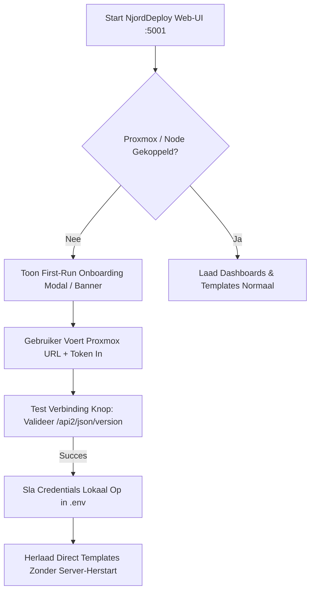

# Specificatie & Architectuur-Instructie: First-Run Onboarding & Proxmox Connection Manager

**Doelproject:** `njord-deploy`
**Datum:** 2026-10-24
**Status:** Approved for Implementation (CMMI Niveau 5)
**Doel:** Eerste-keer-gebruikers op Windows/Linux/macOS een naadloze, zero-terminal onboardingervaring bieden en cryptische "Error loading"-fouten bij ontbrekende infrastructuur-credentials definitief elimineren.

---

## 1. Probleemanalyse & Root Cause (RCA)

Tijdens de validatie van de standalone Windows release (`NjordDeploy-Windows.zip`) op een schone Windows Server 2022 KVM VM (Proxmox VMID 310) trad de volgende situatie op:
1. **Geen Credentials in Distributie:** Releases bevatten om veiligheidsredenen terecht geen productie-`.env`.
2. **Onvolledige Packaging:** Er zat geen `.env.example` in het zip-bestand.
3. **Ontbrekende Onboarding / Settings UI:** De web-UI veronderstelde stilzwijgend dat Proxmox API variabelen (`PROXMOX_HOST`, `PROXMOX_TOKEN_ID`, etc.) al geladen waren in het proces.
4. **Gebrekkige Foutafhandeling:** Het endpoint `POST /api/proxmox/list-templates` faalde met een serverfout, waardoor de template-dropdown in `app.js` de melding `"-- Error loading templates --"` toonde zonder uitleg of herstelpad.

---

## 2. Functionele Eisen & User Experience



### Eisen:
1. **First-Run Detectie:** Bij het openen van de UI controleert de frontend of er een actieve Proxmox/infrastructuurkoppeling is.
2. **Onboarding Banner / Modal:** Indien ongeconfigureerd verschijnt een vriendelijke wizard: *"Welkom bij NjordDeploy! Koppel je Proxmox hypervisor of Raspberry Pi vloot."*
3. **Settings / Connection Manager in Navbar:** Een tandwiel-icoon of status-indicator (*"Proxmox: Niet gekoppeld"*) in de header waarmee instellingen altijd kunnen worden ingezien, getest en gewijzigd.
4. **Live Connection Test:** Een knop *"Test Verbinding"* die via de backend direct een handshake doet met de Proxmox API en het resultaat toont (groen/rood).
5. **Graceful Dropdown Feedback:** De template-selectie toont bij ontbrekende configuratie:
   `"-- Proxmox niet gekoppeld (Klik hier om in te stellen) --"`.

---

## 3. Technische Backend Specificatie (Python / Flask)

### A. Nieuwe of uitgebreide endpoints in `configurator_app/routes/`

#### 1. `GET /api/config/proxmox/status`
Geeft de actuele koppelingsstatus terug zonder geheime tokens te lekken:
```json
{
  "configured": true,
  "host": "https://192.168.1.100:8006",
  "node": "pve",
  "user": "root@pam",
  "token_id": "root@pam!clone-token",
  "has_token_secret": true,
  "connection_healthy": true
}
```

#### 2. `POST /api/config/proxmox/test`
Test de verbinding met meegestuurde (of reeds opgeslagen) gegevens:
* **Request:**
  ```json
  {
    "host": "https://192.168.1.100:8006",
    "token_id": "root@pam!clone-token",
    "token_secret": "90517cef-db2a-486e-8510-1091ec8b33d5",
    "node": "pve",
    "verify_ssl": false
  }
  ```
* **Backend actie:** Doet een `GET /api2/json/version` request naar Proxmox.
* **Response:**
  ```json
  {"success": true, "pve_version": "8.2.4", "message": "Verbinding met Proxmox node 'pve' geslaagd."}
  ```

#### 3. `POST /api/config/proxmox/save`
Slaat de gevalideerde configuratie persistent op:
* Schrijft/update de sleutels in het lokale `.env` bestand in de applicatiemap (met respect voor bestaande variabelen).
* Werkt direct `os.environ` in het lopende Python-proces bij, zodat de gebruiker de backend niet handmatig hoeft te herstarten.

#### 4. Foutafhandeling in `POST /api/proxmox/list-templates`
Bij het ontbreken van configuratie retourneert het endpoint een nette HTTP 200 met statusindicatie in plaats van een HTTP 500 crash:
```json
{
  "success": false,
  "configured": false,
  "templates": [],
  "message": "Proxmox is nog niet geconfigureerd. Voeg je Proxmox URL en API-token toe in de Instellingen."
}
```

---

## 4. Technische Frontend Specificatie (HTML / JavaScript)

### A. Template Selector Graceful Error Handling (`app.js`)
Vervang de huidige foutafhandeling rond regel 2980 in `src/configurator_app/static/js/app.js`:

```javascript
const loadVmTemplates = async () => {
    const templateSelect = document.getElementById('vm_template_select');
    if (!templateSelect) return;
    templateSelect.innerHTML = '<option value="">-- Templates laden... --</option>';
    try {
        const res = await fetchAPI('/api/proxmox/list-templates', {
            method: 'POST',
            headers: {'Content-Type': 'application/json'}
        });
        if (res.configured === false) {
            templateSelect.innerHTML = '<option value="">-- Proxmox niet gekoppeld (Configureer in Instellingen) --</option>';
            showProxmoxSetupPrompt();
            return;
        }
        if (res.templates && res.templates.length > 0) {
            templateSelect.innerHTML = '<option value="">-- Selecteer Template --</option>';
            res.templates.forEach(t => {
                const opt = document.createElement('option');
                opt.value = t.vmid;
                opt.textContent = `${t.name} (VMID: ${t.vmid})`;
                templateSelect.appendChild(opt);
            });
        } else {
            templateSelect.innerHTML = '<option value="">-- Geen templates gevonden op node --</option>';
        }
    } catch (err) {
        console.error('Fout bij laden van templates:', err);
        templateSelect.innerHTML = '<option value="">-- Verbindingsfout (Controleer Proxmox instellingen) --</option>';
    }
};
```

### B. Proxmox Settings Modal (`src/configurator_app/templates/partials/settings_modal.html`)
Een compacte Bootstrap modal met velden voor:
* Proxmox Web GUI URL (bijv. `https://192.168.1.100:8006`)
* Node Naam (bijv. `pve`)
* API Token ID (`gebruiker@pam!tokenid`)
* API Token Secret (gemaskeerd password veld)
* Switch: *Negeer self-signed SSL waarschuwingen*
* Knoppen: `[ Test Verbinding ]` en `[ Opslaan & Toepassen ]`

---

## 5. CI/CD Release Packaging (`.github/workflows/release.yml`)

Pas de packaging-stap in `release.yml` aan zodat er in elk installer-archief standaard een `template.env` of `.env.example` wordt meegeleverd:

```yaml
- name: Package executables
  shell: bash
  run: |
    mkdir -p artifact
    cp .env.example artifact/.env.example
    if [ "${{ matrix.os-name }}" = "Windows" ]; then
      cp dist/NjordDeployConfigurator.exe artifact/NjordDeployConfigurator.exe
      cp dist/NjordDeployEditor.exe artifact/NjordDeployEditor.exe
      cp dist/NjordDeployProxmoxTest.exe artifact/NjordDeployProxmoxTest.exe
    else
      cp dist/NjordDeployConfigurator artifact/NjordDeployConfigurator
      cp dist/NjordDeployEditor artifact/NjordDeployEditor
      cp dist/NjordDeployProxmoxTest artifact/NjordDeployProxmoxTest
    fi
```

---

## 6. Gesloten Testprocedure op de Proxmox Windows VM (VM 310)

Om deze hele cyclus deterministisch te testen zodra de feature in `njord-deploy` is geïmplementeerd:

1. **Rollback naar Schone Windows Baseline (Zonder `.env`):**
   ```bash
   ssh root@192.168.1.100 "qm rollback 310 clean-baseline && qm start 310"
   ```
2. **Kopieer de nieuwe Windows Release Build naar VM 310:**
   Upload de nieuw gebouwde `NjordDeploy-Windows.zip` naar de Windows VM.
3. **Start de applicatie op Windows:**
   Start `NjordDeployConfigurator.exe` (zonder `.env` bestand!).
4. **Verifieer in de Browser (`http://192.168.1.100:5001`):**
   * Controleer of de First-Run Onboarding verschijnt.
   * Vul de Proxmox gegevens in via de browser.
   * Druk op *"Test Verbinding"* (moet groen worden).
   * Druk op *"Opslaan"*.
   * Ga naar *"Create New Proxmox VM Target"*: de dropdown hoort nu direct alle 6 templates in te laden!
5. **Geautomatiseerde Runner:**
   Draai [`/home/hvhoek/PycharmProjects/sysops/scripts/test-njorddeploy-windows.sh`](file:///home/hvhoek/PycharmProjects/sysops/scripts/test-njorddeploy-windows.sh) om te verifiëren dat alle L7 tests groen scoren.
