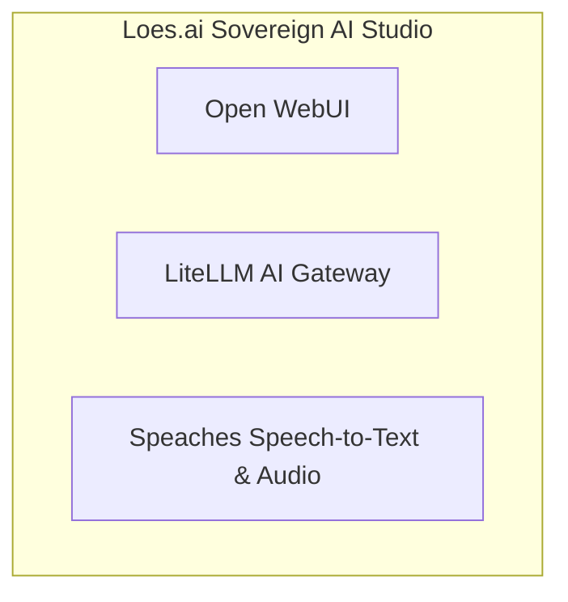

# 📦 NjordDeploy Turnkey Stack: Loes.ai Sovereign AI Studio

> Turnkey GDPR-compliant sovereign AI studio connecting Open WebUI and Speaches local voice transcription directly to the Loes.ai (HostYourAI) European sovereign LLM cluster.

---

## 🧩 Included Components

| Component | Category | Description | Upstream |
|---|---|---|---|
| [`open-webui`](../../component_templates/open-webui/README.md) | AI & LLM Services | Open WebUI is an extensible, feature-rich, and user-friendly web interface for AI models and LLMs, supporting Ollama ... | [Open WebUI](https://openwebui.com/) |
| [`litellm`](../../component_templates/litellm/README.md) | AI & LLM Services | LiteLLM is an AI gateway and LLM proxy that unifies access to 100+ Large Language Models (OpenAI, Gemini, Anthropic, ... | [LiteLLM AI Gateway](https://github.com/BerriAI/litellm) |
| [`speaches`](../../component_templates/speaches/README.md) | AI & LLM Services | Speaches is an open-source, OpenAI-compatible Speech-to-Text (faster-whisper) and Text-to-Speech (Kokoro/Piper) serve... | [Speaches Speech-to-Text & Audio](https://github.com/speaches-ai/speaches) |

---

## 🏗️ Architecture & Topology

---

## ✨ Why this Stack?

- **Zero-Configuration Orchestration:** Every component in this turnkey
  stack is pre-configured to communicate across an isolated internal network.
- **Enterprise-Grade Data Sovereignty:** 100% on-premises deployment
  eliminating dependence on proprietary SaaS ecosystems.
- **Automated Hypervisor Validation:** Every release of this package is
  automatically deployed, health-checked, and validated across 4 Proxmox VE
  matrix quadrants.

---

## 🧪 Verified Quality & Hypervisor Test Report

This turnkey package is verified across 4 hypervisor quadrants (LXC Docker, LXC Podman, VM Docker, VM Podman).
View the full automated execution report in [docs/test-reports/stacks/loes-ai-studio.md](../../docs/test-reports/stacks/loes-ai-studio.md).

---

## 📦 Deploy with NjordDeploy (Recommended)

Deploy the entire **Loes.ai Sovereign AI Studio** bundle with automated secrets generation, reverse proxy configuration, and persistent volume provisioning using the **[NjordDeploy Configurator](https://github.com/HenkVanHoek/njord-deploy)**.
